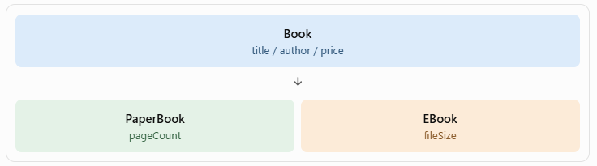

# 継承


## 導入
### 1. 書籍管理システムを考える

書籍管理システムを作ることにします。

書籍には、次の2種類があります。


### 2. まず、1つのBookクラスで管理してみる

```
public class Book {
    String title;
    String author;
    int price;

    // 紙の本用
    int pageCount;

    // 電子書籍用
    int fileSize;
}
```


### 3. Bookクラスで管理する問題点


#### 問題①：使わないフィールドが発生する

- 紙の本にはファイルサイズは必要ありません。
- 電子書籍にはページ数（紙の本としてのページ数）は必ずしも必要ありません。

つまり、オブジェクトによって使わないフィールドが発生します。

#### 問題②：種類ごとに処理を変えるため、条件分岐が増える

書籍情報を表示するとき、紙の本ならページ数、電子書籍ならファイルサイズを表示したくなります。
そのため、種類を表すフィールドを追加し、処理のたびに種類を判定する必要があります。

```
String bookType;

if (bookType.equals("紙の本")) {
    // ページ数を表示
} else if (bookType.equals("電子書籍")) {
    // ファイルサイズを表示
}
```

本の種類が増えるたびに `else if` が増え、コードが複雑になります。

### 4. では、どうすればよいか？

継承 => 共通する情報はBookクラスにまとめて、種類ごとに異なる情報は、それぞれのクラスに持たせればよい




## 継承

- 継承：親クラスの機能を引き継ぐこと
    -既存のクラスのフィールドやメソッドを引き継いで、新しいクラスを作る仕組みです。
- オーバーライド：引き継いだメソッドを子クラスで再定義すること
- ポリモーフィズム：同じ呼び出し方でも、オブジェクトの種類によって異なる動きをすること


## 継承の実装

既存のクラスのフィールドやメソッドを引き継いで、新しいクラスを作る仕組みです。
- 親クラス：スーパークラス
- 子クラス：サブクラス

-キーワードは extends です。

```java
public class PaperBook extends Book {
    int pageCount;
}
```

```java
public class EBook extends Book {
    int fileSize;
}
```

## オーバーライドの実装

### 1. オーバーライドとは？

**オーバーライド**とは、親クラスから引き継いだメソッドを、子クラスで**同じ名前・同じ引数**のまま**中身だけ書き換える**ことです。

書籍情報を表示する `display()` メソッドで考えてみましょう。

| クラス | 表示したい内容 |
|---|---|
| Book（親） | タイトル・著者・価格 |
| PaperBook（子） | タイトル・著者・価格 ＋ **ページ数** |
| EBook（子） | タイトル・著者・価格 ＋ **ファイルサイズ** |

親クラスの `display()` をそのまま使うと、ページ数やファイルサイズが表示されません。
そこで、子クラスで `display()` を**上書き（オーバーライド）**します。

### 2. 親クラス（Book）

まず、親クラスに共通の `display()` メソッドを用意します。

```java
public class Book {
    String title;
    String author;
    int price;

    public Book(String title, String author, int price) {
        this.title = title;
        this.author = author;
        this.price = price;
    }

    public void display() {
        System.out.println("タイトル：" + title);
        System.out.println("著者：" + author);
        System.out.println("価格：" + price + "円");
    }
}
```

### 3. 子クラス（PaperBook）でオーバーライドする

```java
public class PaperBook extends Book {
    int pageCount;

    public PaperBook(String title, String author, int price, int pageCount) {
        super(title, author, price);   // 親クラスのコンストラクタを呼び出す
        this.pageCount = pageCount;
    }

    @Override                          // ① オーバーライドであることを明示
    public void display() {            // ② 親と同じ名前・同じ引数
        super.display();               // ③ 親クラスの display() を呼び出す
        System.out.println("ページ数：" + pageCount);  // ④ 子クラス独自の処理を追加
    }
}
```

#### 解説

① **`@Override`（アノテーション）**
- 「このメソッドは親クラスのメソッドをオーバーライドしています」とコンパイラに伝える目印です。
- メソッド名を `dispaly()` のように打ち間違えると、**コンパイルエラーで教えてくれる**ので、必ず付けましょう。

② **メソッド名・引数・戻り値を親と同じにする**
- 名前や引数が違うと、オーバーライドではなく**別のメソッド**として扱われてしまいます。
- アクセス修飾子は親と同じか、より広くする必要があります（`public` → `private` にはできません）。

③ **`super.display()` で親の処理を再利用する**
- `super.` は「親クラスの〜」という意味です。
- タイトル・著者・価格の表示は親クラスにすでに書いてあるので、**同じコードを繰り返し書かずに済みます**。

④ **子クラス独自の処理を追加する**
- 親の処理のあとに、ページ数の表示を追加しています。

### 4. 子クラス（EBook）でも同様にオーバーライドする

```java
public class EBook extends Book {
    int fileSize;

    public EBook(String title, String author, int price, int fileSize) {
        super(title, author, price);
        this.fileSize = fileSize;
    }

    @Override
    public void display() {
        super.display();
        System.out.println("ファイルサイズ：" + fileSize + "MB");
    }
}
```

### 5. 実行してみる

```java
public class Main {
    public static void main(String[] args) {
        PaperBook paper = new PaperBook("Java入門", "山田太郎", 2800, 300);
        EBook ebook = new EBook("SQL入門", "佐藤花子", 1800, 15);

        paper.display();
        System.out.println();
        ebook.display();
    }
}
```

実行結果

```
タイトル：Java入門
著者：山田太郎
価格：2800円
ページ数：300

タイトル：SQL入門
著者：佐藤花子
価格：1800円
ファイルサイズ：15MB
```

それぞれのクラスでオーバーライドした `display()` が実行されていることがわかります。

ただし、ここでは `PaperBook` 型・`EBook` 型の変数を別々に使っています。
本の種類が増えると、変数も呼び出しも増えてしまいます。
これを**まとめて扱えるようにする仕組み**が、次の章の**ポリモーフィズム**です。

### 6. オーバーライドで何ができるようになったか

- 種類ごとの表示処理を、**それぞれのクラスの中に書けるようになりました**。
- 新しい種類の本を追加するときは、**新しい子クラスを作って `display()` をオーバーライドするだけ**で済みます。

### 7. 補足：`super.display()` を呼ばない場合

`super.display()` を書かないと、親クラスの処理は実行されず、**子クラスの処理だけ**が実行されます。

```java
@Override
public void display() {
    System.out.println("ページ数：" + pageCount);
}
```

実行結果

```
ページ数：300
```

親の処理を「付け足したい」のか「完全に置き換えたい」のかで使い分けます。

### 8. オーバーロードとの違い

名前が似ていますが、別のものです。

| | オーバーライド（Override） | オーバーロード（Overload） |
|---|---|---|
| 意味 | 親のメソッドを子クラスで**上書き** | 同じクラス内で同じ名前のメソッドを**複数定義** |
| メソッド名 | 同じ | 同じ |
| 引数 | **同じ** | **異なる**（型・数・順番） |
| 継承 | 必要 | 不要 |


## ポリモーフィズム

### 1. ポリモーフィズムとは？

**ポリモーフィズム（多態性・多様性）**とは、
**同じ呼び出し方をしても、オブジェクトの種類によって異なる動きをすること**です。

身近な例で考えてみましょう。

> 先生が生徒に「**自己紹介してください**」と言う。
> - Aさんは日本語で話す
> - Bさんは英語で話す
> - Cさんは手話で伝える

先生は相手ごとに指示を変えていません。**同じ指示**なのに、**受け取った人によって動きが変わります**。
これがポリモーフィズムの考え方です。

### 2. オーバーライドとポリモーフィズムの違い

この2つはよく一緒に出てきますが、**別のもの**です。

| | オーバーライド | ポリモーフィズム |
|---|---|---|
| 何か | **書き方（文法）** | **しくみ・考え方** |
| 内容 | 子クラスで親のメソッドを上書きする | 親クラス型でまとめて扱い、同じ呼び出しで種類ごとの動きをさせる |
| 視点 | クラスを**作る側** | クラスを**使う側** |
| 例 | `PaperBook` に `display()` を書き直す | `Book` 型の変数から `display()` を呼ぶ |

関係をひとことで言うと、

> **オーバーライドは、ポリモーフィズムを実現するための手段**

です。
子クラスごとに `display()` をオーバーライドしておくことで、使う側は「`display()` して」と頼むだけで済むようになります。

### 3. ポイント①：親クラス型の変数に、子クラスのインスタンスを入れられる

継承関係にあるとき、**子クラスのインスタンスは親クラス型の変数に代入できます**。

```java
Book book1 = new PaperBook("Java入門", "山田太郎", 2800, 300);
Book book2 = new EBook("SQL入門", "佐藤花子", 1800, 15);
```

「PaperBook は Book の一種」「EBook は Book の一種」なので、`Book` 型として扱えます。
（**is-a 関係**：PaperBook **is a** Book）

逆はできません。`Book` が必ず `PaperBook` とは限らないからです。

```java
PaperBook p = new Book("Java入門", "山田太郎", 2800);  // コンパイルエラー
```

### 4. ポイント②：呼ばれるのは「中身（インスタンス）」のメソッド

```java
Book book1 = new PaperBook("Java入門", "山田太郎", 2800, 300);
book1.display();
```

変数の型は `Book` ですが、実行されるのは **`PaperBook` でオーバーライドした `display()`** です。

実行結果

```
タイトル：Java入門
著者：山田太郎
価格：2800円
ページ数：300
```

| | 決めること |
|---|---|
| 変数の型（`Book`） | **呼び出せるメソッド**（Book に定義されているものだけ） |
| インスタンスの型（`PaperBook`） | **実際に動く処理**（オーバーライドされた中身） |

> 注意：`book1.pageCount` のように、子クラスだけが持つフィールドやメソッドは、`Book` 型の変数からは使えません。

### 5. ポリモーフィズムを使った例

`Book` 型のリストに、種類の違う本をまとめて入れて、拡張for文で順番に表示します。

```java
import java.util.*;

public class PolymorphismMain {
    public static void main(String[] args) {

        // Book型のArrayListを作成
        ArrayList<Book> books = new ArrayList<>();

        // 異なる種類のオブジェクトを追加
        books.add(new PaperBook("Java入門", "山田太郎", 2800, 300));
        books.add(new EBook("SQL入門", "佐藤花子", 1800, 15));

        // 拡張for文で取り出して表示
        for (Book book : books) {
            book.display();   // ← 同じ呼び出し
            System.out.println();
        }
    }
}
```

実行結果

```
タイトル：Java入門
著者：山田太郎
価格：2800円
ページ数：300

タイトル：SQL入門
著者：佐藤花子
価格：1800円
ファイルサイズ：15MB
```

`book.display()` という**1行の同じ呼び出し**なのに、
- 中身が `PaperBook` ならページ数を表示
- 中身が `EBook` ならファイルサイズを表示

と、**種類に応じて動きが変わっています**。これがポリモーフィズムです。

### 6. 導入の問題がどう解決されたか

ポリモーフィズムを使わない場合（導入の問題②）

```java
for (Book book : books) {
    if (book.bookType.equals("紙の本")) {
        // ページ数を表示
    } else if (book.bookType.equals("電子書籍")) {
        // ファイルサイズを表示
    }
    // 種類が増えるたびに else if が増える…
}
```

ポリモーフィズムを使う場合

```java
for (Book book : books) {
    book.display();   // 種類の判定は不要！
}
```

- **種類を判定する `if` 文が不要**になります。
- 新しい種類（例：AudioBook）を追加しても、**使う側（for文）のコードは変更しなくてよい**です。
  子クラスを作って `display()` をオーバーライドするだけで、そのまま動きます。

### 7. まとめ

| 用語 | ひとことで |
|---|---|
| 継承 | 親クラスの機能を引き継いで、新しいクラスを作る |
| オーバーライド | 引き継いだメソッドを、子クラスで書き直す |
| ポリモーフィズム | 親クラス型でまとめて扱い、同じ呼び出しで種類ごとに違う動きをさせる |

**継承** で親子関係を作り、**オーバーライド** で子クラスごとの動きを用意し、**ポリモーフィズム** でまとめて扱う、という流れです。


## 課題

### 問題1：継承

- Book クラスを継承した AudioBook クラスを作成しなさい。
- 以下のフィールドを追加すること。
    - duration：再生時間（整数型・分）

### 問題2

- display() メソッドをオーバーライドし、次の情報を表示しなさい。
    - タイトル
    - 著者
    - 価格
    - 再生時間

### 問題3：ポリモーフィズム

Mainクラスで次の処理を実装しなさい。
1. Book型の配列を3つ用意する。
2. PaperBook、EBook、AudioBookのインスタンスをそれぞれ1つずつ格納する。
3. 拡張for文を使って、すべての書籍の情報を表示する。