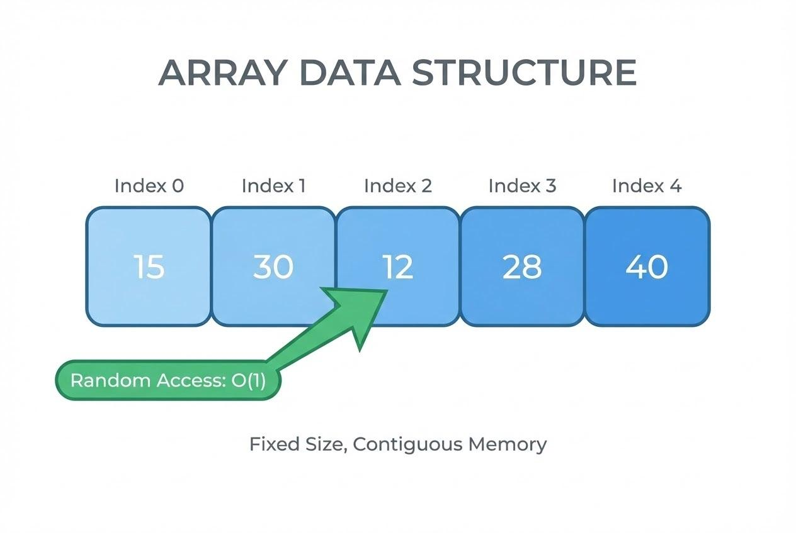
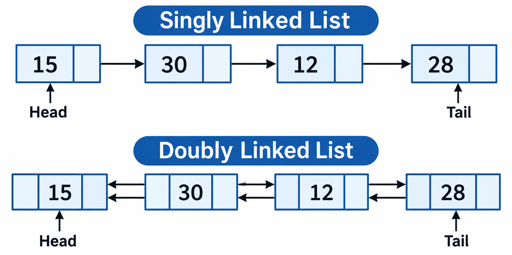

## コレクションとは

コレクションとは、複数のデータをまとめて管理するための仕組み

コレクションフレームワークは、たくさんのオブジェクトのインスタンスを効率よく操作するためのデータ構造の集まりです。

配列もデータ構造の一つです。
- 配列：決まった数のデータを、番号（インデックス）で管理する
- コレクション：データを追加・削除するなど、柔軟に管理できる仕組みがある

Javaのコレクションには、主にリスト（List）、セット（Set）、マップ（Map）があります。
- リスト（List）：データを順番に管理する。同じ値を複数登録できる。
- セット（Set）：重複しないデータを管理する。
- マップ（Map）：キーと値を組み合わせて管理する。

| 種類        | 例          | 特徴         |
| --------- | ---------- | ---------- |
| List（リスト） | 商品一覧       | 順番があり、重複OK |
| Set（セット）  | メールアドレスの集合 | 重複NG       |
| Map（マップ）  | 学生番号 → 学生名 | キーと値の組み合わせ |


## ArrayList

## 1. 基本の書き方

```
ArrayList<String> points = new ArrayList<String>();
```

これは、次のように短く書くこともできます。

```
ArrayList<String> points = new ArrayList<>();
```

右側の `<>` はダイヤモンド演算子と呼ばれます。左側に `Integer` と書いてあるので、右側の型を省略できます。


| 書き方                                                     |   |
| ------------------------------------------------------- | --------- |
| `ArrayList<String> points = new ArrayList<String>();` | 基本   |
| `ArrayList<String> points = new ArrayList<>();`        | 省略形  |


## ラッパークラス

## LinkedList

### ArrayList


- インデックスで素早くアクセスできる
- 途中への追加・削除は苦手



- 要素の追加・削除が得意
- インデックスによるアクセスは苦手


## Set

## Map

## イテレーター
- Iteratorは、コレクションに格納されているデータを、先頭から順番に取り出すための仕組み。
- ArrayListのように番号で管理できるものもあれば、HashSetのように番号で管理できないものもあります。
Iteratorを使えば、データの管理方法が違っていても、同じ方法でデータを取り出すことができます。

### 基本の書き方

```java
Iterator<String> it = names.iterator();   // ① Iterator を取り出す
while (it.hasNext()) {                    // ② 次のデータがあるか調べる
    String name = it.next();              // ③ 次のデータを取り出す
    System.out.println(name);
}
```

| メソッド | すること |
| --- | --- |
| `iterator()` | コレクションから Iterator を取り出す |
| `hasNext()` | 次のデータがあれば `true`、なければ `false` |
| `next()` | 次のデータを取り出す |
| `remove()` | 今 `next()` で取り出したデータを削除する |

### Iterator のいいところ

**① List でも Set でも Map でも、同じ書き方で取り出せる**（sampleiterator/Sample01.java）

| | Iterator の取り出し方 |
| --- | --- |
| List | `list.iterator()` |
| Set | `set.iterator()` |
| Map | `map.keySet().iterator()`（キーの集まりにしてから） |

Iterator を取り出したあとの `while (it.hasNext())` 〜 `it.next()` の書き方は、すべて同じです。

**② 中身が何のコレクションかを知らなくてよい**（sampleiterator/Sample02.java）

Iterator を受け取るメソッドを1つ作っておけば、List でも Set でも同じメソッドで表示できます。

```java
public static void printAll(Iterator<String> it) {
    while (it.hasNext()) {
        System.out.println(it.next());
    }
}
```

**③ 取り出しながら、安全に削除できる**（sampleiterator/Sample03.java）

拡張for文の中でコレクションの `remove()` を使うと、`ConcurrentModificationException` というエラーになります。
Iterator の `remove()` を使えば、取り出しながら削除できます。

```java
Iterator<Integer> it = points.iterator();
while (it.hasNext()) {
    int point = it.next();
    if (point < 50) {
        it.remove();   // 今取り出したデータを削除する
    }
}
```

> 拡張for文（`for (String name : names)`）も、実は内部で Iterator を使っています。
> そのため、拡張for文も List・Set・Map（`keySet()`）のどれにでも使えます。
